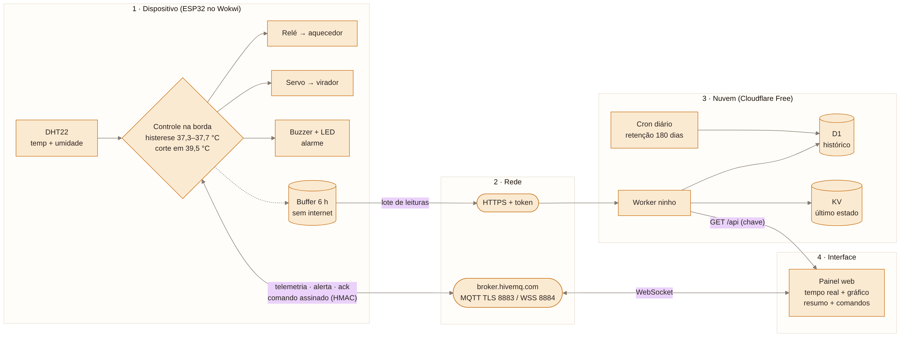

# Ninho — chocadeira inteligente

Trabalho N2 de IoT (AMF · Sistemas de Informação · Prof. Leonam V. Hemann · 2026/02)
**Dupla:** Brayan Martins · Mell Campos

> Para pequenos produtores rurais, que perdem ninhadas inteiras quando a chocadeira esquenta ou esfria sem ninguém ver,
> o **Ninho** sente a temperatura e a umidade (DHT22), decide quando aquecer, quando virar os ovos e quando alarmar,
> e age com o aquecedor (relé), o virador (servo) e a sirene (buzzer + LED), **mesmo sem internet**.



## O que o sistema faz

- Mantém a chocadeira em **37,5 °C**: liga o aquecedor abaixo de 37,3 °C e desliga acima de 37,7 °C (histerese).
- **Corta o aquecedor na hora** se passar de 39,5 °C e dispara o alarme.
- Alarma (buzzer + LED) se a temperatura ficar fora de 36,5–38,5 °C por mais de 2 min.
- Vira os ovos a cada 1 h e para no dia 19 do ciclo de 21 dias.
- Falha do sensor → **estado seguro**: aquecedor desligado, LED piscando e alerta.
- Sem internet, o controle continua e as leituras ficam num buffer de 6 h, reenviado quando a rede volta.
- Painel web em tempo real (WebSocket), com histórico, resumo por hora, alertas e comandos confirmados (ack).

## Arquitetura (4 camadas)

| Camada | O que tem |
|---|---|
| Dispositivo | ESP32 (Wokwi), DHT22, relé, servo, buzzer, LED. Controle na borda, estado seguro, buffer, NVS. |
| Rede | Wi-Fi · MQTT com TLS 8886 no `test.mosquitto.org` · HTTPS (keep-alive) para o Worker · NTP · HMAC nas mensagens |
| Nuvem | Cloudflare Worker `ninho` (Free) · D1 (histórico) · KV (último estado) · cron de retenção (180 dias) |
| Interface | Painel servido pelo Worker em `/` · WebSocket WSS 8081 · gráfico · resumo SQL · comandos com ack |

### Tópicos MQTT

| Tópico | Quem publica → quem assina |
|---|---|
| `sis1a/ninho/chocadeira1/telemetria` | ESP32 (30 s) → painel |
| `sis1a/ninho/chocadeira1/estado` | ESP32 (retido, + LWT offline) → painel |
| `sis1a/ninho/chocadeira1/alerta` | ESP32 (cooldown) → painel |
| `sis1a/ninho/chocadeira1/comando` | painel (assinado HMAC) → ESP32 |
| `sis1a/ninho/chocadeira1/ack` | ESP32 → painel |

### Segurança

- TLS em tudo (MQTT 8886, WSS 8081, HTTPS) e **certificado conferido** com `setCACert` (sem `setInsecure`).
- Broker público → comandos assinados com **HMAC-SHA256**; o ESP32 recusa assinatura errada, comando velho (>120 s) e repetido, e valida a faixa do valor.
- Worker: gravação só com `DEVICE_TOKEN`, leitura só com `PAINEL_KEY`.
- Nenhum segredo no repositório: `firmware/secrets.h` está no `.gitignore`.

## Estrutura

```
firmware/   sketch.ino, diagram.json, libraries.txt, certs.h, secrets.example.h
worker/     src/index.js (rotas), src/painel.html, schema.sql, wrangler.toml, dist/worker.js
docs/       caderno de projeto (.docx), prints dos testes, diagrama
```

## Como montar

### 1. Nuvem (Cloudflare, plano Free)
1. Crie um banco **D1** (`ninho-historico`) e rode `worker/schema.sql` no Console.
2. Crie um **KV** (`ninho-estado`).
3. Crie um Worker `ninho`, cole `worker/dist/worker.js` (gerado com `node worker/build.mjs`) e publique.
4. Em *Settings → Bindings*: `DB` → D1 e `KV` → KV.
5. Em *Settings → Variables and Secrets*, crie dois **Secrets**: `DEVICE_TOKEN` e `PAINEL_KEY` (textos longos e aleatórios).
6. Em *Trigger events*, cron `0 6 * * *`.

Com o Wrangler: `npx wrangler d1 execute ninho-historico --remote --file=worker/schema.sql`, `npx wrangler secret put DEVICE_TOKEN`, `npx wrangler deploy`.

### 2. ESP32 (Wokwi)
1. Projeto ESP32 novo em [wokwi.com](https://wokwi.com).
2. Copie `sketch.ino`, `diagram.json`, `libraries.txt` e `certs.h`.
3. Crie a aba `secrets.h` a partir de `secrets.example.h`, com a URL do Worker, o `DEVICE_TOKEN` e a `PAINEL_KEY`.
4. Entre na sua conta do Wokwi (sem login o gateway de internet do Wokwi recusa a conexão) e **não salve** o projeto com as chaves (projeto free é público).
5. Rode. O Serial mostra Wi-Fi → NTP → MQTT conectado → leituras gravadas no Worker.

| Componente | GPIO |
|---|---|
| DHT22 | 15 |
| Relé (aquecedor) | 26 |
| Servo (virador) | 13 |
| Buzzer | 23 |
| LED de alarme | 4 |

`#define DEMO 1` encurta os tempos para a apresentação (alarme 20 s, viragem 30 s, 1 dia = 3 min, cooldown 60 s).

### 3. Painel
Abra `https://ninho.<seu-subdominio>.workers.dev/` e entre com a `PAINEL_KEY`.

## Como testar

Pelo Serial Monitor: `s` silenciar · `v` virar · `f` falha do sensor · `d` +1 dia · `r` reiniciar ciclo · `a37.8` alvo · `w` liga/desliga o Wi-Fi (teste sem internet).

| Teste | O que fazer | Esperado | Evidência |
|---|---|---|---|
| Aquecedor | DHT22 em 37,0 °C | lâmpada acende | `docs/prints/02` |
| Superaquecimento | DHT22 em 40 °C | alarme e aquecedor desligado na hora | `docs/prints/03` |
| Falha do sensor | comando `f` | `FALHA_SENSOR`, aquecedor OFF | `docs/prints/04` |
| Valor inválido | `a42` | `REJEITADO` | `docs/prints/05` |
| Sem internet | comando `w`, esperar, `w` de novo | controle segue; buffer reenviado sem duplicar | `docs/prints/10` |
| Comando falso / velho / repetido | publicar no tópico sem a chave, com `ts` antigo, ou o mesmo comando 2× | `COMANDO RECUSADO` (assinatura invalida / expirado / repetido) | `docs/prints/11` |
| Worker | `POST /api/leituras` sem token | `401` | — |
| Painel | comando pelo painel; `f` no Serial | "executado" com ack; alerta `falha_sensor` | `docs/prints/06`–`09` |

> No Wokwi, a aba da simulação precisa ficar **visível**: em segundo plano o Chrome congela a simulação e o ESP32 cai do broker (LWT "offline").
> O primeiro envio HTTPS ao Worker leva ~14 s (aperto de mão TLS conferindo o certificado no ESP32 simulado); com a conexão reaproveitada, os seguintes levam ~0,7 s.
